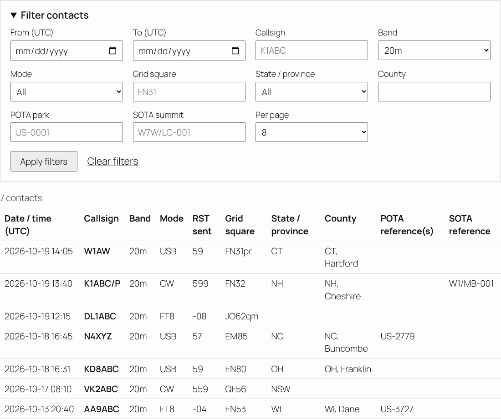
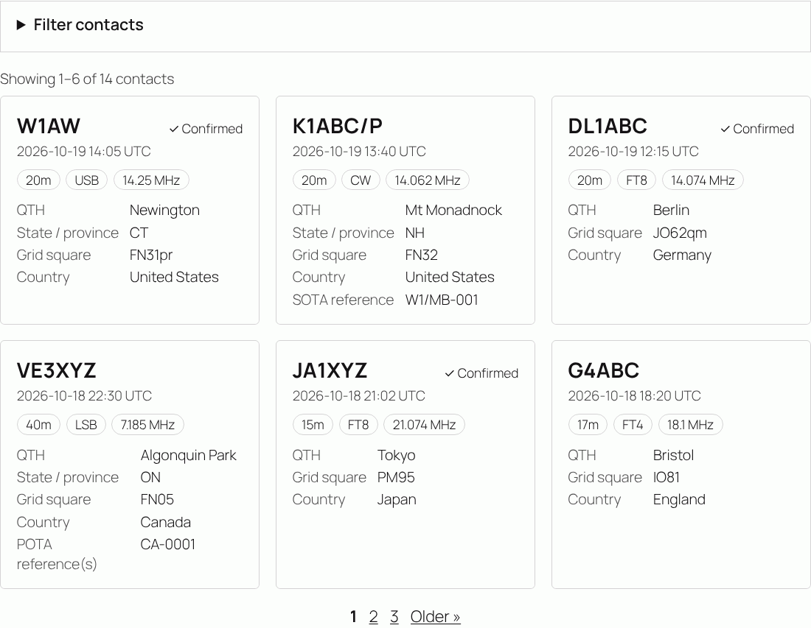
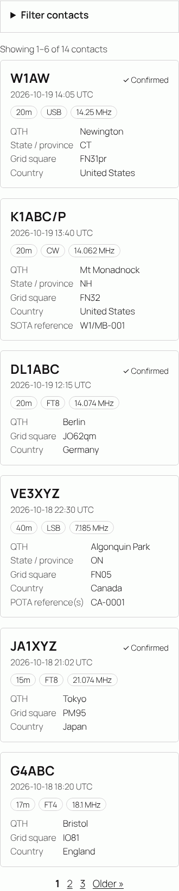

# WP Logbook

An amateur radio logbook for WordPress. Log your contacts (QSOs) from the WordPress dashboard, import and export ADIF, show your log on your site as a filterable table or as tiles, and optionally upload contacts to your [QRZ.com Logbook](https://logbook.qrz.com/) through the QRZ.com Logbook API.

The QRZ.com upload is optional. The logbook works the same with it switched off.

## Contents

- [Features](#features)
- [Requirements](#requirements) · [Installation](#installation)
- [Logging contacts](#logging-contacts)
- [QRZ.com Logbook upload (optional)](#qrzcom-logbook-upload-optional)
- [Showing your log on your site](#showing-your-log-on-your-site): [quick start](#quick-start), [table and tiles](#table-and-tiles), [pagination](#pagination), [filters](#filters), [recipes](#recipes), [attribute reference](#attribute-reference), [styling](#styling)
- [Import and export](#import-and-export)
- [Logbook field layout](#logbook-field-layout)
- [Privacy and data](#privacy-and-data) · [For developers](#for-developers) · [References](#references)

## Features

- **Quick QSO entry**: the start time follows a UTC clock until you change it. The band is filled in from the frequency, and RST defaults to 59, 599 or blank (dB reports) depending on the mode. While you type a callsign, the form shows your earlier contacts with that station and fills in name, QTH, grid and country from the last one. **Save & log another** keeps your band and mode.
- **Logbook screen**: search, band and mode filters, sorting, and bulk actions (ADIF export, delete, QRZ.com upload).
- **ADIF field layout**: 73 fields that follow the ADIF 3.1.8 specification (see [field layout](#logbook-field-layout)), covering contest exchanges, POTA/SOTA/WWFF, satellites, and paper/LoTW/eQSL QSL status.
- **ADIF import** with duplicate detection. Handles files from other logging programs: submodes written as modes (`MODE=USB`, `MODE=FT4`), frequencies in kHz, UTF-8 or Latin-1 text, and lengths counted in bytes or characters.
- **Export** to ADIF (`.adi`) or CSV, either everything or only selected QSOs.
- **Public display**: `[wp_logbook]` (table) and `[wp_logbook_tiles]` (tiles) with optional pagination and visitor filters for date, callsign, band, mode, grid, state, county, POTA, SOTA and more. Each filter can be switched on or off per shortcode. `[wp_logbook_stats]` shows totals.
- **Optional QRZ.com Logbook upload**: on save, in the background, or in bulk. Edits replace the QRZ.com copy and deletions can be passed on.
- Translation-ready (`languages/wp-logbook.pot`).

## Requirements

- WordPress 6.0 or later
- PHP 7.4 or later
- For QRZ.com upload: a QRZ.com account and the Logbook API key of your QRZ.com logbook. QRZ.com may require a paid subscription for API uploads.

## Installation

1. Copy this folder to `wp-content/plugins/wp-logbook`, or upload a zip of it under **Plugins → Add New → Upload Plugin**.
2. Activate **WP Logbook**. Activation creates the `{prefix}wplb_qsos` table.
3. Under **Logbook → Settings**, enter your station callsign and grid square. They pre-fill every new QSO.
4. Log contacts under **Logbook → Log a QSO**, or import an existing log under **Logbook → Import / Export**.

## Logging contacts

All times are UTC. Required fields are callsign, start date and time, mode, and either a band or a frequency. A frequency must lie inside the chosen band. Grid squares are checked as Maidenhead locators (`FN31` or `FN31pr`), and callsigns are stored in upper case.

The mode picker lists common modes first. Some of them are ADIF submodes and are stored as the correct pair: USB is stored as `SSB`/`USB`, FT4 as `MFSK`/`FT4`, JS8 as `MFSK`/`JS8`, and DMR as `DIGITALVOICE`/`DMR`. Every other ADIF mode follows.

The less common fields are in collapsible sections: contacted station details, activations and contests, my station, propagation and satellite, QSL, and private notes.

## QRZ.com Logbook upload (optional)

### Setting it up

1. On QRZ.com, open your logbook, go to **Settings** and copy the **API key** of the logbook you want to upload to.
2. In WordPress, open **Logbook → Settings → QRZ.com Logbook**. Tick **Upload QSOs to my QRZ.com Logbook**, paste the key and click **Test connection**. The test shows the logbook's callsign, owner and QSO count. Then save.
   - You can also keep the key out of the database by adding this to `wp-config.php`:
     ```php
     define( 'WPLB_QRZ_API_KEY', 'XXXX-XXXX-XXXX-XXXX' );
     ```
3. Make sure your **station callsign** matches the callsign of the QRZ.com logbook. QRZ.com rejects QSOs whose `STATION_CALLSIGN` does not match, and the connection test warns you about a mismatch.

The key is stored in its own option that is not autoloaded, and it is never printed back into the settings page.

### How uploads work

Each QSO has a QRZ.com status, shown in the logbook list and on the edit screen:

| Status | Meaning |
|---|---|
| Not uploaded | Waiting to be uploaded. |
| On QRZ.com | Accepted by QRZ.com. The QRZ.com log ID is stored. |
| Changed since upload | Edited after upload. The next upload replaces the QRZ.com copy. |
| Upload failed | Rejected by QRZ.com. The reason is shown, for example `wrong station_callsign` or `outside date range`. |
| Not for QRZ.com | Never uploaded. Set it per QSO or with a bulk action. |

Settings:

- **Upload on save** (default on) uploads each QSO right after it is logged or edited, and the confirmation message reports the result.
- **Background upload** uploads up to 50 waiting QSOs every hour through WP-Cron.
- **Edits** (default on): an edited QSO is re-sent with `OPTION=REPLACE`. If you changed the callsign, band, mode or time, QRZ.com no longer sees the QSO as the same contact and creates a new record. In that case the plugin deletes the old record, using its stored log ID.
- **Deletions** (default off): deleting QSOs here also deletes them from QRZ.com.

**Upload now** on the logbook screen, and the bulk action **Upload to QRZ.com now**, send QSOs in batches of 10 with a progress bar, so large logs don't hit PHP time limits. An upload stops at the first problem that isn't specific to one QSO, such as an invalid key, `RESULT=AUTH`, a network error or an HTTP error, and leaves the remaining QSOs waiting. QSOs that QRZ.com reports as duplicates count as uploaded. Failed uploads can be queued again with **Retry them**. Editing a failed QSO also queues it again.

Every field is sent to QRZ.com except your private **notes** and the contacted station's **email** address. If a QSO has no station callsign, the one from the settings is sent.

### QRZ.com Logbook API calls

The plugin follows the [QRZ.com Logbook API](https://www.qrz.com/docs/logbook/QRZLogbookAPI.html): an HTTP `POST` to `https://logbook.qrz.com/api` with form-encoded `KEY` and `ACTION` fields. Responses are `name=value` pairs joined with `&`, for example `RESULT=OK&LOGID=130877825&COUNT=1`.

| Action | Used for | Parameters sent | Response fields read |
|---|---|---|---|
| `STATUS` | Test connection | – | `RESULT`, `COUNT`, logbook details (`BOOK_NAME`, `CALLSIGN`, `OWNER`, `CONFIRMED`, `DXCC_COUNT`, `START_DATE`, `END_DATE`), also when nested in `DATA` |
| `INSERT` | Uploading a QSO | `ADIF` (one record ending in `<EOR>`), `OPTION=REPLACE` for QSOs that were uploaded before | `RESULT` (`OK`, `REPLACE`, `FAIL`, `AUTH`), `LOGID`, `COUNT`, `REASON` |
| `DELETE` | Removing QSOs from QRZ.com | `LOGIDS` (comma-separated) | `RESULT` (`OK`, `PARTIAL`, `FAIL`), `COUNT`, `LOGIDS` |

Requests carry a descriptive `User-Agent` (`WP-Logbook/<version> (WordPress/<version>) <station callsign>`).

## Showing your log on your site

| Shortcode | Shows |
|---|---|
| `[wp_logbook]` | Your QSOs in a table, with filters and page links |
| `[wp_logbook_tiles]` | The same QSOs as tiles (cards) |
| `[wp_logbook_stats]` | Totals and QSO counts per band and mode |

`[wp_logbook]` and `[wp_logbook_tiles]` take the same attributes. The only difference is the default layout.

### Quick start

1. In WordPress, go to **Pages → Add New** and give the page a title, for example *Logbook*.
2. Add a **Shortcode** block (type `/shortcode` in the editor). In the classic editor, type the shortcode straight into the content.
3. Enter `[wp_logbook]` or `[wp_logbook_tiles]` and publish.

Without attributes, the shortcode uses the defaults from **Logbook → Settings → Public logbook**: which columns to show, QSOs per page, and whether the callsign filter is shown. The attributes described below change any of this for a single page.

> **Tip:** many themes keep page content narrow. For more table columns or tiles per row, put the Shortcode block inside a **Group** block and set the group to **Wide width** or **Full width**.

### Table and tiles



*`[wp_logbook page_size="8" page_sizes="8,25,50" columns="time_on,callsign,band,mode,rst_sent,gridsquare,state,cnty,pota_ref,sota_ref"]`, filtered to the 20m band.*

The **table** shows one QSO per row, newest first, with the columns named in `columns`. When the columns don't fit the page, the table scrolls sideways inside its own box, so the rest of the page keeps its layout.



*`[wp_logbook_tiles page_size="6" collapse_filters="yes" columns="time_on,callsign,band,mode,freq,qth,state,gridsquare,country,pota_ref,sota_ref,confirmed"]`*

Each **tile** shows:

- the callsign at the top, with **✓ Confirmed** when `confirmed` is in `columns` and the QSO is confirmed;
- the date and time (UTC), when `time_on` is in `columns`;
- band, mode and frequency as small labels, for those of `band`, `mode` and `freq` that are in `columns`;
- every other column in `columns` that has a value, as label and value. Empty fields are left out, so tiles stay short.

Tiles fill the available width with as many per row as fit, and stack one per row on phones:



### Columns

`columns` takes a comma-separated list of the keys below, shown in the order you give them. For example: `columns="time_on,callsign,band,mode,country"`. Only these public fields can be shown; private notes, email addresses and QSL details never appear on the site.

| Key | Shows |
|---|---|
| `time_on` | Date and time, UTC |
| `callsign` | Callsign |
| `band` | Band |
| `freq` | Frequency in MHz |
| `mode` | Submode when there is one (USB, FT4), otherwise the mode |
| `rst_sent` | RST sent |
| `rst_rcvd` | RST received |
| `name` | Name |
| `qth` | QTH |
| `gridsquare` | Grid square |
| `country` | Country |
| `comment` | Comment |
| `state` | State / province |
| `cnty` | County (ADIF `CNTY`, e.g. `MA, Middlesex`) |
| `dxcc` | DXCC entity number |
| `cont` | Continent name |
| `cqz` | CQ zone |
| `ituz` | ITU zone |
| `iota` | IOTA |
| `sota_ref` | SOTA reference |
| `pota_ref` | POTA reference(s) |
| `wwff_ref` | WWFF reference |
| `contest_id` | Contest ID |
| `station_callsign` | Station callsign |
| `tx_pwr` | Your transmit power in watts |
| `my_gridsquare` | My grid square |
| `my_sota_ref` | My SOTA reference |
| `my_pota_ref` | My POTA reference(s) |
| `prop_mode` | Propagation mode |
| `sat_name` | Satellite name |
| `confirmed` | ✓ when confirmed by QSL card, LoTW or eQSL |

### Pagination

| Attribute | Default | What it does |
|---|---|---|
| `pagination` | `yes` | `yes` shows page links below the QSOs. `no` shows only the latest `page_size` QSOs, without links. |
| `page_size` | **QSOs per page** setting (25) | Number of QSOs per page, 1–500. |
| `page_sizes` | – | Adds a **Per page** menu so visitors can choose, e.g. `page_sizes="10,25,50,100"`. `page_size` is the starting choice and is added to the menu if it's missing. |

Above the QSOs a line says what is shown, e.g. *Showing 26–50 of 132 contacts*. Page links show the first and last page and the pages around the current one: `« Newer 1 … 4 5 6 7 8 … 20 Older »`. Moving between pages keeps the visitor's filters. A link past the last page shows the last page instead, which can happen after a filter shrinks the results.

```
[wp_logbook page_size="50"]                          50 per page
[wp_logbook page_size="25" page_sizes="25,50,100"]   visitors can switch to 50 or 100
[wp_logbook_tiles pagination="no" page_size="6"]     the 6 latest contacts, no page links
```

### Filters

The filter form sits above the QSOs. A visitor fills in one or more fields and clicks **Apply filters**. Only QSOs that match **all** the filled-in fields are shown, and empty fields are ignored. **Clear filters** shows everything again.

| Filter | Shows QSOs where… | Control | On by default |
|---|---|---|:-:|
| `date` | the contact was between the two dates (UTC, both days included); either date can be left empty | From / To dates | ✓ |
| `callsign` | the callsign starts with the text, also after a prefix: `W1AW` finds `W1AW`, `W1AW/P` and `VE3/W1AW`; `DL` finds every DL station | Text | ✓ |
| `band` | the band is the chosen one | Menu | ✓ |
| `mode` | the mode is the chosen one (USB and LSB are listed separately from SSB, FT4 separately from FT8) | Menu | ✓ |
| `grid` | the grid square starts with the text: `FN` or `FN31` | Text | ✓ |
| `state` | the state or province is the chosen one | Menu | ✓ |
| `county` | the county contains the text: `Middlesex` | Text | ✓ |
| `pota` | the POTA park of the station you worked contains the text: `US-1234` | Text | ✓ |
| `sota` | the SOTA summit of the station you worked contains the text: `W7W/LC-001` | Text | ✓ |
| `country` | the country is the chosen one | Menu | |
| `continent` | the continent is the chosen one | Menu | |
| `wwff` | the WWFF reference contains the text: `KFF-0001` | Text | |
| `iota` | the IOTA reference starts with the text: `NA-001` | Text | |
| `my_pota` | **your** park (your activations) contains the text; the field suggests your parks | Text | |
| `my_sota` | **your** summit contains the text; the field suggests your summits | Text | |
| `contest` | the contest ID is the chosen one | Menu | |
| `satellite` | the satellite is the chosen one | Menu | |
| `station` | the station callsign you used is the chosen one (handy for club sites) | Menu | |
| `confirmed` | the QSO is (or is not) confirmed by QSL card, LoTW or eQSL | Menu | |

How matching works:

- Text filters ignore upper and lower case.
- **Starts with** filters (`callsign`, `grid`, `iota`) are good for prefixes. **Contains** filters (`county`, `pota`, `sota`, `wwff`, `my_pota`, `my_sota`) also find one park in a multi-park QSO such as `US-1234,US-5678`.
- Menus list only values that occur in the QSOs this logbook shows. A menu with only one value is left out, because it couldn't filter anything.
- Times are UTC, like everything in the log.

### Choosing which filters appear

| Attribute | Example | What it does |
|---|---|---|
| `filters` | `filters="date,callsign,state"` | Shows exactly these filters, in this order. `filters="all"` shows every filter, and `filters="none"` hides the filter form. Without `filters`, the defaults marked ✓ above are shown. `gridsquare`, `cnty` and `cont` work as names too. |
| `filter_<name>` | `filter_date="no"` `filter_my_pota="yes"` | Switches one filter off or on, after `filters` is applied. Use it to change the defaults without listing them all. |
| `collapse_filters` | `collapse_filters="yes"` | Starts with the filter form folded under a **Filter contacts** heading that visitors click to open. The form opens by itself while a filter is in use. Useful on phones and when many filters are on. |

The callsign filter is in the default set only while **Callsign search** is ticked under **Logbook → Settings**. `filter_callsign="yes"` or `"no"` overrides the setting for one page.

```
[wp_logbook filter_date="no"]                                  defaults without the date range
[wp_logbook filter_country="yes" filter_continent="yes"]       defaults plus country and continent
[wp_logbook filters="callsign"]                                just a callsign search
[wp_logbook filters="date,callsign,grid,county,state,pota,sota" collapse_filters="yes"]
```

### Fixed filters

A filter can also be fixed to a value in the shortcode. A fixed filter applies to every visitor, its form field is not shown, and menus only list values within it. Visitors can still narrow the results further with the other filters.

| Attribute | Value | Example |
|---|---|---|
| `date_from`, `date_to` | Date as YYYY-MM-DD (UTC, both days included) | `date_from="2026-01-01" date_to="2026-12-31"` |
| `callsign` | One station, including its portable forms (exact match, not starts-with) | `callsign="W1AW"` |
| `band` | ADIF band | `band="6m"` |
| `mode` | Mode or submode; `SSB` includes USB and LSB | `mode="FT8"` |
| `grid` | Start of a grid square | `grid="FN"` |
| `state`, `country`, `continent` | Exact value; continents as two-letter codes (`NA`, `EU`, `AS`, `AF`, `OC`, `SA`, `AN`) | `state="CT"` `continent="EU"` |
| `county`, `pota`, `sota`, `wwff` | Text the value contains | `pota="US-1234"` |
| `iota` | Start of an IOTA reference | `iota="EU-"` |
| `my_pota`, `my_sota` | Text your own reference contains | `my_pota="US-1234"` |
| `contest`, `satellite`, `station` | Exact value | `contest="ARRL-FD"` `station="W1XYZ"` |
| `confirmed` | `yes` or `no` | `confirmed="yes"` |

Every POTA, SOTA and WWFF reference contains a hyphen, so `pota="-"` shows only QSOs that have a POTA park.

### Recipes

| Page | Shortcode |
|---|---|
| Complete log, every filter, visitor-chosen page size | `[wp_logbook filters="all" page_sizes="25,50,100"]` |
| "Am I in your log?" | `[wp_logbook filters="callsign" columns="time_on,callsign,band,mode"]` |
| Latest contacts on the home page | `[wp_logbook_tiles pagination="no" page_size="6" filters="none"]` |
| One POTA activation | `[wp_logbook_tiles my_pota="US-1234" filters="callsign,band,mode" columns="time_on,callsign,band,mode,state,confirmed"]` |
| All your activations | `[wp_logbook my_pota="-" filters="date,band,callsign" columns="time_on,callsign,band,mode,my_pota_ref"]` |
| Pick one of your parks | `[wp_logbook filters="my_pota,date,band" columns="time_on,callsign,band,mode,my_pota_ref"]` |
| Parks you hunted | `[wp_logbook pota="-" filters="state,date,band" columns="time_on,callsign,band,mode,pota_ref,state"]` |
| Summits you chased | `[wp_logbook sota="-" filters="date,band,callsign" columns="time_on,callsign,band,mode,sota_ref"]` |
| A contest | `[wp_logbook contest="ARRL-FD" filters="band,mode,state" page_size="100"]` |
| Confirmed 6m DX | `[wp_logbook band="6m" confirmed="yes" filters="country,continent,grid"]` |
| One year | `[wp_logbook date_from="2026-01-01" date_to="2026-12-31"]` |
| Club site, one page per station | `[wp_logbook station="W1XYZ"]` |
| Club site, one page for all stations | `[wp_logbook filter_station="yes"]` |

### Links to filtered views

Filtered views are ordinary links, so visitors can bookmark or share them, and you can link to them from posts:

```
https://example.com/logbook/?wplb_state=CT&wplb_band=20m
https://example.com/logbook/?wplb_callsign=W1AW
https://example.com/logbook/?wplb_from=2026-06-01&wplb_to=2026-06-30&wplb_pg=2
```

| Parameter | Value |
|---|---|
| `wplb_<filter>` | A filter value, e.g. `wplb_pota=US-1234`, `wplb_mode=FT8`, `wplb_confirmed=yes` |
| `wplb_from`, `wplb_to` | Dates for the `date` filter (YYYY-MM-DD) |
| `wplb_pg` | Page number |
| `wplb_size` | Page size; must be one of `page_sizes` |

A parameter only works when its filter is shown on that page.

### More than one logbook on a page

Give each logbook an `id`. Its filters and page links then only affect that logbook, and its parameters become `wplb_<id>_<filter>`:

```
[wp_logbook_tiles id="latest" pagination="no" page_size="4" filters="none"]
[wp_logbook id="full" page_size="25"]
```

### Attribute reference

| Attribute | Values | Default |
|---|---|---|
| `layout` | `table`, `tiles` | `table` for `[wp_logbook]`, `tiles` for `[wp_logbook_tiles]` |
| `columns` | Comma-separated column keys | **Columns** setting |
| `pagination` | `yes`, `no` | `yes` |
| `page_size` | 1–500 | **QSOs per page** setting |
| `page_sizes` | Comma-separated numbers | – |
| `filters` | Comma-separated filter names, `all`, `none` | `date,callsign,band,mode,grid,state,county,pota,sota` |
| `filter_<name>` | `yes`, `no` | – |
| `collapse_filters` | `yes`, `no` | `no` |
| `id` | Letters, numbers, `-`, `_` | – |
| Fixed filters | See [Fixed filters](#fixed-filters) | – |
| `limit` | Older name of `page_size` | – |
| `search` | Older name of `filter_callsign` | – |

### Styling

The shortcodes load a small stylesheet (handle `wplb-public`) that leaves fonts and colours to your theme. To adjust the look, add CSS under **Appearance → Customize → Additional CSS** or in the Site Editor's **Styles → Additional CSS**. For example:

```css
/* Wider tiles with a light background */
.wplb-tiles { grid-template-columns: repeat(auto-fill, minmax(18em, 1fr)); }
.wplb-tile { background: #f6f7f9; }

/* Border colour of the filter form, tiles and labels */
.wplb-logbook { --wplb-border: #c3c4c7; }
```

| Class | Element |
|---|---|
| `.wplb-logbook`, `.wplb-layout-table`, `.wplb-layout-tiles` | The whole logbook |
| `.wplb-filters`, `.wplb-filters-panel`, `.wplb-filters-title` | Filter form, its fold-away panel and heading |
| `.wplb-filter`, `.wplb-filter-<name>` | One filter field, e.g. `.wplb-filter-pota` |
| `.wplb-filter-actions`, `.wplb-filters-clear` | Apply button and **Clear filters** link |
| `.wplb-summary`, `.wplb-empty` | "Showing …" line and the no-results message |
| `.wplb-table-wrap`, `.wplb-table`, `.wplb-col-<column>` | Table, its scroll box, and cells of one column |
| `.wplb-tiles`, `.wplb-tile` | Tile grid and one tile |
| `.wplb-tile-head`, `.wplb-tile-call`, `.wplb-tile-confirmed`, `.wplb-tile-time` | Tile heading, callsign, confirmed mark, date |
| `.wplb-chips`, `.wplb-chip`, `.wplb-chip-band`, `.wplb-chip-mode`, `.wplb-chip-freq` | Band, mode and frequency labels |
| `.wplb-tile-fields` | Label/value list of a tile |
| `.wplb-pagination`, `.wplb-page`, `.wplb-page-current`, `.wplb-prev`, `.wplb-next` | Page links |

Developers can change attribute defaults for the whole site with WordPress's `shortcode_atts_wp_logbook` and `shortcode_atts_wp_logbook_tiles` filters.

### Upgrading from 1.0

- The separate "Are you in the log?" box is replaced by the callsign filter, which matches callsigns that **start with** the text. The **Callsign lookup** setting is now called **Callsign search** and decides whether that filter is shown by default.
- Pages now show the filter form by default. Add `filters="none"` to a shortcode to show the log without it.
- `limit` (now `page_size`), `search` (now `filter_callsign`) and the fixed `band`, `mode`, `station` and `callsign` attributes still work as before.

### `[wp_logbook_stats]`

Shows totals (QSOs, unique callsigns, DXCC entities or countries, grid squares, first and latest QSO) and QSO counts per band and per mode.

| Attribute | Default | Description |
|---|---|---|
| `show` | `totals,bands,modes` | Which parts to show. |
| `station` | – | Only QSOs made as this station callsign. |

## Import and export

- **ADIF export** writes ADIF 3.1.8 `.adi` files in plain ASCII, as the ADI format requires. Accented letters are transliterated (`José` → `Jose`), so every reader agrees on field lengths. The QRZ.com state is included as `QRZCOM_QSO_UPLOAD_STATUS` / `QRZCOM_QSO_UPLOAD_DATE`.
- **CSV export** keeps the full UTF-8 text and all columns. Use it for spreadsheets or a complete backup.
- **ADIF import** skips QSOs already in the log, meaning the same callsign, band and mode within one minute. It fills in a station callsign for records without one, and can mark imported QSOs as already on QRZ.com. `APP_QRZLOG_LOGID` and `QRZCOM_QSO_UPLOAD_STATUS` from QRZ.com exports are kept. Records with problems are reported with the reason.

## Logbook field layout

QSOs are stored in their own table (`{prefix}wplb_qsos`). Each column corresponds to an ADIF field, using the field definitions, band plan and mode/submode lists of [ADIF 3.1.8](https://www.adif.org/). Dates and times are UTC. **Public** marks fields that can be shown with `[wp_logbook]` and `[wp_logbook_tiles]`. **QRZ.com** marks fields sent when uploading.

**Contact**

| Field | ADIF | Format | Public | QRZ.com |
|---|---|---|:-:|:-:|
| Callsign | `CALL` | Callsign, max 32 | ✓ | ✓ |
| Start (UTC) | `QSO_DATE + TIME_ON` | Date + time (UTC) | ✓ | ✓ |
| End (UTC) | `QSO_DATE_OFF + TIME_OFF` | Date + time (UTC) |  | ✓ |
| Band | `BAND` | ADIF band | ✓ | ✓ |
| Frequency (MHz) | `FREQ` | MHz | ✓ | ✓ |
| Mode | `MODE` | ADIF mode | ✓ | ✓ |
| Submode | `SUBMODE` | ADIF submode (set by the mode picker) |  | ✓ |
| RST sent | `RST_SENT` | Text, max 10 | ✓ | ✓ |
| RST received | `RST_RCVD` | Text, max 10 | ✓ | ✓ |
| Name | `NAME` | Text, max 100 | ✓ | ✓ |
| QTH | `QTH` | Text, max 100 | ✓ | ✓ |
| Grid square | `GRIDSQUARE` | Maidenhead locator | ✓ | ✓ |
| Country | `COUNTRY` | Text, max 64 | ✓ | ✓ |
| Comment | `COMMENT` | Text, max 255 | ✓ | ✓ |

**Contacted station**

| Field | ADIF | Format | Public | QRZ.com |
|---|---|---|:-:|:-:|
| State / province | `STATE` | Text (upper case), max 32 | ✓ | ✓ |
| County | `CNTY` | Text, max 64 | ✓ | ✓ |
| DXCC entity code | `DXCC` | Integer 0–999 | ✓ | ✓ |
| Continent | `CONT` | Enumeration (NA, SA, EU, AF, OC, AS, AN) | ✓ | ✓ |
| CQ zone | `CQZ` | Integer 1–40 | ✓ | ✓ |
| ITU zone | `ITUZ` | Integer 1–90 | ✓ | ✓ |
| IOTA | `IOTA` | Text (upper case), max 10 | ✓ | ✓ |
| QSL via | `QSL_VIA` | Text, max 100 |  | ✓ |
| Email | `EMAIL` | Email, max 100 |  | — |

**Activations & contests**

| Field | ADIF | Format | Public | QRZ.com |
|---|---|---|:-:|:-:|
| SOTA reference | `SOTA_REF` | Text (upper case), max 20 | ✓ | ✓ |
| POTA reference(s) | `POTA_REF` | Text (upper case), max 100 | ✓ | ✓ |
| WWFF reference | `WWFF_REF` | Text (upper case), max 20 | ✓ | ✓ |
| Special interest group | `SIG` | Text, max 50 |  | ✓ |
| SIG information | `SIG_INFO` | Text, max 100 |  | ✓ |
| Contest ID | `CONTEST_ID` | Text (upper case), max 50 | ✓ | ✓ |
| Serial sent | `STX` | Integer 0–99999999 |  | ✓ |
| Exchange sent | `STX_STRING` | Text, max 50 |  | ✓ |
| Serial received | `SRX` | Integer 0–99999999 |  | ✓ |
| Exchange received | `SRX_STRING` | Text, max 50 |  | ✓ |

**My station**

| Field | ADIF | Format | Public | QRZ.com |
|---|---|---|:-:|:-:|
| Station callsign | `STATION_CALLSIGN` | Callsign, max 32 | ✓ | ✓ |
| Operator | `OPERATOR` | Callsign, max 32 |  | ✓ |
| TX power (W) | `TX_PWR` | Watts | ✓ | ✓ |
| Rig | `MY_RIG` | Text, max 100 |  | ✓ |
| Antenna | `MY_ANTENNA` | Text, max 100 |  | ✓ |
| My grid square | `MY_GRIDSQUARE` | Maidenhead locator | ✓ | ✓ |
| My city | `MY_CITY` | Text, max 100 |  | ✓ |
| My state / province | `MY_STATE` | Text (upper case), max 32 |  | ✓ |
| My county | `MY_CNTY` | Text, max 64 |  | ✓ |
| My country | `MY_COUNTRY` | Text, max 64 |  | ✓ |
| My DXCC entity code | `MY_DXCC` | Integer 0–999 |  | ✓ |
| My CQ zone | `MY_CQ_ZONE` | Integer 1–40 |  | ✓ |
| My ITU zone | `MY_ITU_ZONE` | Integer 1–90 |  | ✓ |
| My IOTA | `MY_IOTA` | Text (upper case), max 10 |  | ✓ |
| My SOTA reference | `MY_SOTA_REF` | Text (upper case), max 20 | ✓ | ✓ |
| My POTA reference(s) | `MY_POTA_REF` | Text (upper case), max 100 | ✓ | ✓ |
| My WWFF reference | `MY_WWFF_REF` | Text (upper case), max 20 |  | ✓ |
| My special interest group | `MY_SIG` | Text, max 50 |  | ✓ |
| My SIG information | `MY_SIG_INFO` | Text, max 100 |  | ✓ |

**Propagation & satellite**

| Field | ADIF | Format | Public | QRZ.com |
|---|---|---|:-:|:-:|
| Propagation mode | `PROP_MODE` | Enumeration (AS, AUE, AUR, BS, ECH, EME, ES, F2, FAI, GWAVE, INTERNET, ION, IRL, LOS, MS, RPT, RS, SAT, TEP, TR) | ✓ | ✓ |
| Satellite name | `SAT_NAME` | Text (upper case), max 30 | ✓ | ✓ |
| Satellite mode | `SAT_MODE` | Text (upper case), max 20 |  | ✓ |
| Receive band (split) | `BAND_RX` | ADIF band |  | ✓ |
| Receive frequency (MHz) | `FREQ_RX` | MHz |  | ✓ |

**QSL**

| Field | ADIF | Format | Public | QRZ.com |
|---|---|---|:-:|:-:|
| QSL card sent | `QSL_SENT` | Enumeration (Y, N, R, Q, I) |  | ✓ |
| QSL sent date | `QSLSDATE` | Date |  | ✓ |
| QSL sent via | `QSL_SENT_VIA` | Enumeration (B, D, E) |  | ✓ |
| QSL card received | `QSL_RCVD` | Enumeration (Y, N, R, I) |  | ✓ |
| QSL received date | `QSLRDATE` | Date |  | ✓ |
| QSL received via | `QSL_RCVD_VIA` | Enumeration (B, D, E) |  | ✓ |
| QSL message | `QSLMSG` | Text, max 255 |  | ✓ |
| LoTW sent | `LOTW_QSL_SENT` | Enumeration (Y, N, R, Q, I) |  | ✓ |
| LoTW sent date | `LOTW_QSLSDATE` | Date |  | ✓ |
| LoTW confirmed | `LOTW_QSL_RCVD` | Enumeration (Y, N, R, I) |  | ✓ |
| LoTW confirmed date | `LOTW_QSLRDATE` | Date |  | ✓ |
| eQSL sent | `EQSL_QSL_SENT` | Enumeration (Y, N, R, Q, I) |  | ✓ |
| eQSL sent date | `EQSL_QSLSDATE` | Date |  | ✓ |
| eQSL confirmed | `EQSL_QSL_RCVD` | Enumeration (Y, N, R, I) |  | ✓ |
| eQSL confirmed date | `EQSL_QSLRDATE` | Date |  | ✓ |

**Notes**

| Field | ADIF | Format | Public | QRZ.com |
|---|---|---|:-:|:-:|
| Notes (private) | `NOTES` | Multi-line text |  | — |

Bookkeeping columns: `qrz_status`, `qrz_logid`, `qrz_upload_date`, `qrz_message`, `created_at`, `updated_at`.

Bands follow the ADIF band plan, from `2190m` to `submm`, with frequency limits used to derive the band. Modes are the ADIF 3.1.8 mode list, and their submodes are stored separately (`MODE` + `SUBMODE`).

## Privacy and data

- Private notes and email addresses are never shown publicly and never sent to QRZ.com. Only public fields can be shown on the site or used as filters.
- Deleting the plugin keeps your log unless **Delete all QSOs and settings when the plugin is deleted** is ticked under **Logbook → Settings**.
- By default only administrators (`manage_options`) can use the logbook. The `wplb_capability` filter changes the capability for the logbook screens; the settings always need `manage_options`.

## For developers

Filters:

| Filter | Purpose |
|---|---|
| `wplb_capability` | Capability required for the logbook screens (default `manage_options`). |
| `wplb_fields` | Field definitions (labels and flags). |
| `wplb_common_modes` | Modes listed first in the mode picker. |
| `wplb_adif_fields` | ADIF fields written for a QSO (`$fields, $qso, $context` where context is `file` or `qrz`). |
| `wplb_qrz_request_args` | Arguments passed to `wp_remote_post()` for QRZ.com. |
| `wplb_qrz_endpoint` | QRZ.com Logbook API URL. |
| `wplb_qrz_batch_size` | QSOs per upload request from the logbook screen (default 10). |
| `wplb_qrz_cron_batch_size` | QSOs per background upload run (default 50). |

Actions: `wplb_qso_inserted ( $id, $row )`, `wplb_qso_updated ( $id, $changes )` and `wplb_before_delete_qsos ( $ids )`.

Tests and coding standards:

```sh
php tests/unit-tests.php                                     # no WordPress needed
WPLB_INTEGRATION=1 wp eval-file tests/integration-tests.php  # disposable site with an empty logbook; QRZ.com is mocked
phpcs                                                        # WordPress Coding Standards 3 + PHPCompatibilityWP (phpcs.xml.dist)
```

## References

- [QRZ.com Logbook API developer guide](https://www.qrz.com/docs/logbook/QRZLogbookAPI.html)
- [ADIF specification](https://www.adif.org/), version 3.1.8: fields, bands, modes and submodes
